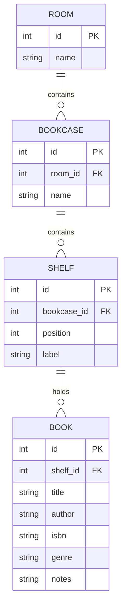

# Home Library       

> Home Library catalogues a private book collection and links every book to the exact shelf it is stored on, so finding a book at home takes seconds instead of minutes.

- Getting Started
  * [About the Project](#about-the-project)
  * [Features](#features)
  * [Tech Stack](#tech-stack)
  * [Data Model](#data-model)
- Running Home Library
  * [Using Docker Compose](#using-docker-compose)
  * [Deploying on a Raspberry Pi](#deploying-on-a-raspberry-pi)
  * [Configuration](#configuration)
- [Develop](#develop)
  * [Setup](#setup)
  * [Run](#run)
  * [Project Structure](#project-structure)
- [Roadmap](#roadmap)
- [FAQ](#faq)

## About the Project

Home Library started as a personal project for my mother, whose book collection is spread across many bookcases throughout the house. Over time it became difficult to keep track of which books are owned and where each one is stored.

The application solves this with a simple web interface: every book is recorded once and assigned to a room, a bookcase and a shelf. The whole system runs self-hosted on a Raspberry Pi in the home network, so the data stays private and no external service is required.

## Features

**Book management**: add, edit and remove books with title, author, ISBN, genre and personal notes.

**Location tracking**: define rooms, bookcases and individual shelves, then assign each book to a precise location. Books can be moved at any time.

**Search and filter**: find books by title, author, genre or location.

**Shelf overview**: see at a glance which books are stored on a given shelf.

**Accessible interface**: a clean, straightforward UI designed for users without a technical background.

> [!NOTE]
> Home Library is in early development. Features listed here describe the intended scope of the first release.

## Tech Stack

| Layer      | Technology                         |
| ---------- | ---------------------------------- |
| Frontend   | React, Vite                        |
| Backend    | Node.js, Express.js (REST API)     |
| Database   | PostgreSQL                         |
| Deployment | Docker, Docker Compose             |
| Hosting    | Raspberry Pi 4 (4 GB RAM, ARM64)   |

## Data Model

Locations are organised hierarchically. A book always belongs to exactly one shelf.



## Using Docker Compose

The complete stack (frontend, backend and database) runs with a single command.

> [!IMPORTANT]
> Docker and Docker Compose must be installed on the host machine.

**Installation**:

```bash
git clone https://github.com/C3PHEI/home_library.git
cd home_library
cp .env.example .env
```

**Run it**:

```bash
docker compose up -d
```

The application is then available at `http://localhost:8080`.

## Deploying on a Raspberry Pi

Home Library is designed to run on a Raspberry Pi 4 with 4 GB of RAM. All container images are built for the `arm64` architecture and kept lightweight to fit the limited resources of the device.

```bash
# on the Raspberry Pi
git clone https://github.com/C3PHEI/home_library.git
cd home_library
cp .env.example .env
docker compose up -d --build
```

Once running, the library is reachable from any device in the home network at `http://<raspberry-pi-ip>:8080`.

> [!TIP]
> Assign a static IP address to the Raspberry Pi in your router so the address does not change after a restart.

## Develop

### Setup

```bash
# Node.js 22 (LTS) or later is required

git clone https://github.com/C3PHEI/home_library.git
cd home_library

# install backend dependencies
cd server && npm install

# install frontend dependencies
cd ../client && npm install
```

### Run

```bash
# start only the database in Docker
docker compose up -d db

# start the backend (http://localhost:3000)
cd server && npm run dev

# start the frontend (http://localhost:5173)
cd client && npm run dev
```

### Project Structure

```
home_library/
├── client/               # React + Vite frontend
├── server/               # Express.js REST API
├── database/             # SQL schema and migrations
├── docker-compose.yml
├── .env.example
└── README.md
```

## Roadmap

**Version 1.0**

- [ ] Database schema for rooms, bookcases, shelves and books
- [ ] REST API with full CRUD support
- [ ] Book list with search and filters
- [ ] Location management (rooms, bookcases, shelves)
- [ ] Docker Compose setup for ARM64
- [ ] Deployment on Raspberry Pi 4

**Future ideas**

- [ ] Automatic book data lookup by ISBN
- [ ] Barcode scanning via smartphone camera
- [ ] Lending tracker (who borrowed which book and when)
- [ ] Cover images
- [ ] Automated database backups and data export

## FAQ

### Why self-hosted instead of a cloud service?

The collection is private household data. Running everything on a Raspberry Pi in the home network keeps the data local, avoids subscription costs and works without an internet connection.

### Will it run on other hardware?

Yes. Any machine that runs Docker can host Home Library. The Raspberry Pi 4 is simply the primary target, which is why the setup is optimised for low memory usage and the ARM64 architecture.

### Is the data backed up?

The database is stored in a persistent Docker volume, so data survives container restarts and updates. Automated backups are planned for a later version.

---

**Home Library**, ˈhoʊm ˈlaɪbrəri (n): a collection of books ~~somewhere in the house~~ on the third shelf of the bookcase in the living room.
